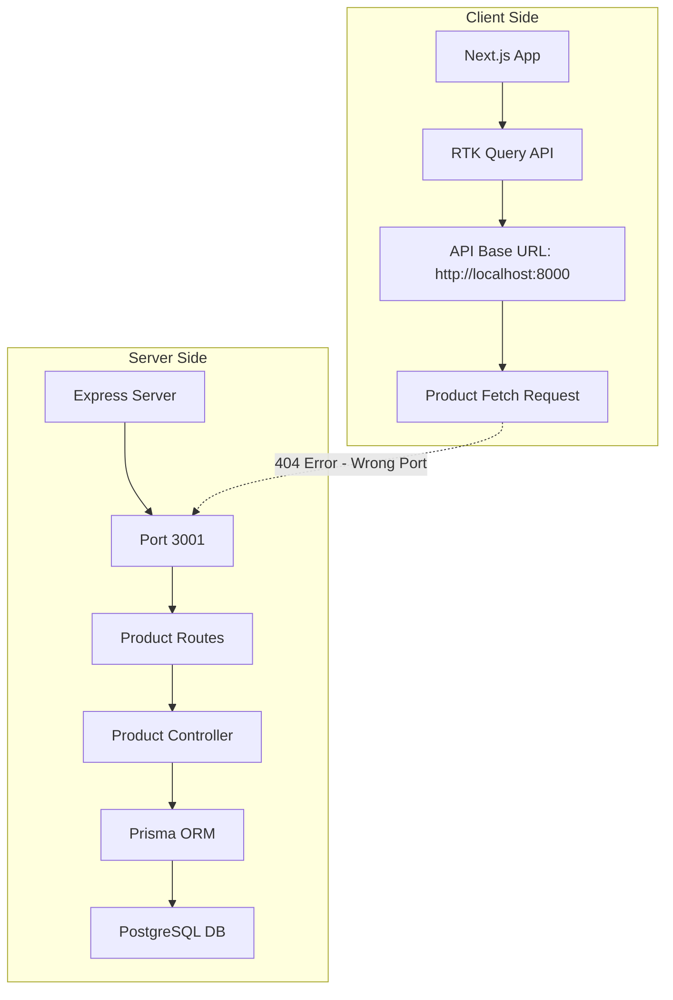
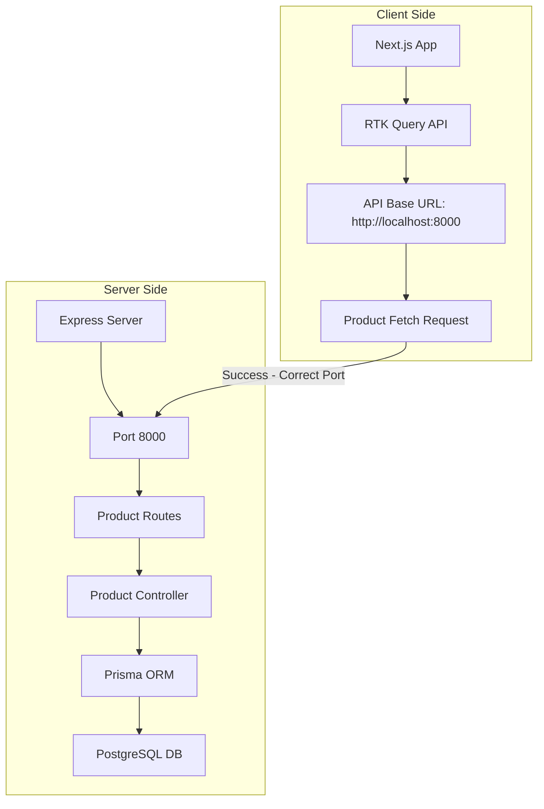
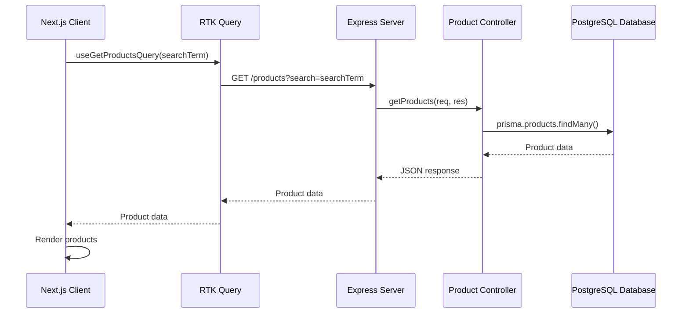

# Architecture Diagram

## Current Architecture (with Port Mismatch Issue)



## Proposed Solution (Fixed Port Configuration)



## Data Flow Diagram



## Error Flow (Current Issue)

```mermaid
sequenceDiagram
    participant Client as Next.js Client
    participant API as RTK Query
    participant Server as Express Server
    
    Client->>API: useGetProductsQuery(searchTerm)
    API->>Server: GET http://localhost:8000/products
    Note over API,Server: Server is running on port 3001
    Server-->>API: 404 Not Found
    API-->>Client: isError = true
    Client->>Client: Display "Failed to fetch products"